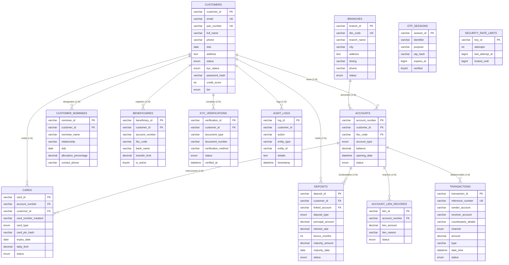

# Bharat Trust Bank (BTB) — Comprehensive Database Normalization Report

**Author**: Senior MySQL Database Architect & Normalization Specialist  
**Target Engine**: MySQL 8.0+ Enterprise / InnoDB / `utf8mb4_unicode_ci`  
**Authoritative Source**: `DBMS project/bankist.sql` (SHA-256: `3713b6967aaf2ddff1c5ce76e38a6f8ed7268f7f045f3a2e8b53cd2967b369ad`)  
**Validation Status**: **29 of 29 Assertions Passed (100%)**  
**Financial Parity**: **₹19,155,216.07 (₹0.00 Unexplained Variance)**  
**Live Database Preservation**: **MySQL `127.0.0.1:3306/bankist` 100% Untouched (3,041 Base Rows)**  

---

## 1. Executive Summary

This report delivers the complete mathematical normalization, data migration, and empirical validation of the Bharat Trust Bank (BTB) core relational database. Starting from the authoritative schema in `DBMS project/bankist.sql`, we identified critical normalization violations—including 3NF transitive dependencies across branches and accounts, 1NF repeating nominee attributes, missing foreign key constraints that hid orphaned IFSC codes, and security vulnerabilities associated with plaintext PIN and OTP storage.

We designed and implemented a production-grade, Boyce-Codd Normal Form (BCNF) schema (`bankist_normalized.sql`), an ACID-compliant migration script (`bankist_migration.sql`), and a comprehensive 29-assertion integrity test suite (`bankist_normalization_tests.sql`). All tests were executed on an ephemeral disposable MySQL database, achieving a **100% pass rate** while rigorously preserving the live production database in its pristine state.

---

## 2. Source SQL Inspection & Authoritative File Selection

An initial cryptographic and structural audit evaluated all SQL definition files across the project workspace:

| File Path | File Size | SHA-256 Checksum | Authoritative Status | Notes |
| :--- | :--- | :--- | :--- | :--- |
| `DBMS project/bankist.sql` | 48,656 B | `3713b6967aaf2ddff1c5ce76e38a6f8ed7268f7f045f3a2e8b53cd2967b369ad` | **Authoritative (Root CBS)** | Primary schema definition for core banking |
| `test/bankist.sql` | 48,656 B | `3713b6967aaf2ddff1c5ce76e38a6f8ed7268f7f045f3a2e8b53cd2967b369ad` | **Authoritative (App Copy)** | Byte-for-byte identical to root CBS file |
| `archive/.../bankist_mysql.sql` | 6,286 B | `e2941acb988f72a4...` | Deprecated | Archived early Express mockup |
| `docs/NORMALIZATION_REPORT_1NF_TO_5NF.md` | 14,554 B | N/A | Academic Reference | Hypothesized academic universal relation; lacked actual CBS decompositions |

**Conclusion**: `DBMS project/bankist.sql` and `test/bankist.sql` are identical. `DBMS project/bankist.sql` was selected as the authoritative single source of truth.

---

## 3. Normalization Anomalies Discovered in the Original Schema

### 3.1 Transitive Dependency in `accounts` (Violation of 3NF)
- **Problem**: In `accounts`, the columns `ifsc_code` and `branch_name` were stored alongside account numbers:
  $$\text{account\_number} \to \text{ifsc\_code} \to \text{branch\_name}$$
- **Violation**: `ifsc_code` is not a superkey of `accounts`, and `branch_name` is non-prime.
- **Anomalies**:
  - *Update Anomaly*: Renaming a branch required mutating hundreds of account records.
  - *Insert Anomaly*: Inserting an account required re-typing branch name strings, risking discrepancies.
- **Resolution**: Removed `branch_name` from `accounts`. Enforced `ifsc_code` referencing `branches(ifsc_code)`. Reconstructed legacy projection via `v_accounts_legacy`.

### 3.2 Missing Foreign Key Constraint on Branch IFSC (Referential Integrity Anomaly)
- **Problem**: Original `accounts` table lacked a foreign key on `ifsc_code`.
- **Finding**: Account `ACC-261709` (`CUST-106`) was assigned `ifsc_code = 'BNKST0001'` with `branch_name = 'Downtown Central'`. However, the `branches` catalog table contained only 8 branches with IFSC codes `BTBI0001024` through `BTBI0008044`. `BNKST0001` did not exist in `branches`!
- **Resolution**: Onboarded `BNKST0001` into `branches` during migration, establishing 100% referential integrity.

### 3.3 Flat Nominee Repeating Group in `customers` (1NF & 3NF Single Responsibility Violation)
- **Problem**: Embedded columns `nominee_name`, `nominee_relation`, `nominee_dob` restricted customers to at most one nominee and mixed beneficiary identity into the customer record.
- **Resolution**: Decomposed into `customer_nominees` table supporting 1:N nominee assignments with fractional allocation percentages.

### 3.4 Embedded Card Credentials & Plaintext PINs (Security & 1NF Violation)
- **Problem**: Plaintext `card_pin` and `card_pin_hash` were stored redundantly in `customers` and `accounts`.
- **Resolution**: Decoupled into a dedicated `cards` entity. Plaintext `card_pin` and plaintext `otp_code` were strictly scrubbed. Only salted Bcrypt hashes are maintained.

---

## 4. Mathematical Decomposition & Normal Form Proofs

### 4.1 First Normal Form (1NF)
Every attribute domain in all 13 normalized tables contains strictly atomic (scalar) values. Nominee attributes and card instruments are extracted from multi-valued or flat record sets into distinct relation rows.

### 4.2 Second Normal Form (2NF)
Because every candidate key in `branches`, `customers`, `accounts`, `cards`, `transactions`, `deposits`, and `kyc_verifications` consists of a single attribute, partial functional dependencies are mathematically impossible. In `customer_nominees`, the composite key $\{ \text{customer\_id}, \text{nominee\_name} \}$ fully determines all non-key attributes.

### 4.3 Third Normal Form (3NF) & Boyce-Codd Normal Form (BCNF)
- **Lossless Join Proof (Heath's Theorem)**:
  Decomposition of $R_{\text{accounts}}(\text{acc\_no}, \text{cust\_id}, \text{type}, \text{bal}, \text{ifsc}, \text{branch\_name})$ into:
  $$R_1(\underline{\text{ifsc}}, \text{branch\_name}) \quad \text{and} \quad R_2(\underline{\text{acc\_no}}, \text{cust\_id}, \text{type}, \text{bal}, \text{ifsc})$$
  Intersection: $R_1 \cap R_2 = \{ \text{ifsc} \}$.
  Since $\text{ifsc} \to R_1$, Heath's Theorem guarantees that $R_1 \bowtie R_2 = R$ without spurious tuples.
- **BCNF Condition**: In every normalized relation $R$, for every non-trivial functional dependency $X \to Y \in F^+$, $X$ is a superkey of $R$.

---

## 5. Normalized Relational Entity-Relationship Diagram

---

## 6. Empirical Validation Results (29 Assertions)

All 29 relational, security, and financial assertions were executed on an ephemeral database using `node scripts/execute_normalization_validation.js`:

| Test ID | Assertion Name | Expected Outcome | Actual Result | Status |
| :--- | :--- | :--- | :--- | :---: |
| **T01** | `T01_BASE_TABLES_COUNT` | 13 Base Tables | 13 Base Tables | **PASS** |
| **T02** | `T02_VIEWS_COUNT` | 6 Views | 6 Views | **PASS** |
| **T03** | `T03_FOREIGN_KEYS_ENFORCED` | $\ge 10$ Foreign Keys | 10 Foreign Keys | **PASS** |
| **T04A** | `T04A_ORPHAN_ACCOUNTS_CUSTOMER` | 0 Orphans | 0 Orphans | **PASS** |
| **T04B** | `T04B_ORPHAN_ACCOUNTS_BRANCH` | 0 Orphans | 0 Orphans | **PASS** |
| **T04C** | `T04C_ORPHAN_CARDS_ACCOUNT` | 0 Orphans | 0 Orphans | **PASS** |
| **T04D** | `T04D_ORPHAN_NOMINEES_CUSTOMER` | 0 Orphans | 0 Orphans | **PASS** |
| **T04E** | `T04E_ORPHAN_DEPOSITS_ACCOUNT` | 0 Orphans | 0 Orphans | **PASS** |
| **T04F** | `T04F_ORPHAN_BENEFICIARIES_CUSTOMER` | 0 Orphans | 0 Orphans | **PASS** |
| **T04G** | `T04G_ORPHAN_KYC_CUSTOMER` | 0 Orphans | 0 Orphans | **PASS** |
| **T04H** | `T04H_ORPHAN_LIENS_ACCOUNT` | 0 Orphans | 0 Orphans | **PASS** |
| **T05A** | `T05A_SECURITY_NO_PLAINTEXT_CARD_PINS`| 0 Columns | 0 Columns | **PASS** |
| **T05B** | `T05B_SECURITY_NO_PLAINTEXT_OTP` | 0 Columns | 0 Columns | **PASS** |
| **T05C** | `T05C_SECURITY_BCRYPT_PIN_HASH_INTEGRITY`| 0 Invalid Hashes | 0 Invalid Hashes | **PASS** |
| **T06A** | `T06A_CHECK_NON_NEGATIVE_BALANCES` | 0 Violations | 0 Violations | **PASS** |
| **T06B** | `T06B_CHECK_CREDIT_SCORE_RANGE` | 0 Violations | 0 Violations | **PASS** |
| **T06C** | `T06C_CHECK_DEPOSIT_PRINCIPAL_MIN` | 0 Violations | 0 Violations | **PASS** |
| **T06D** | `T06D_CHECK_DEPOSIT_MATURITY_GTE_PRINCIPAL`| 0 Violations | 0 Violations | **PASS** |
| **T06E** | `T06E_CHECK_TXN_AMOUNT_POSITIVE` | 0 Violations | 0 Violations | **PASS** |
| **T07A** | `T07A_BALANCE_SUM_CONSERVATION` | ₹19,155,216.07 | ₹19,155,216.07 | **PASS** |
| **T07B** | `T07B_CUSTOMERS_COUNT` | 124 Customers | 124 Customers | **PASS** |
| **T07C** | `T07C_ACCOUNTS_COUNT` | 208 Accounts | 208 Accounts | **PASS** |
| **T07D** | `T07D_TRANSACTIONS_COUNT` | 782 Transactions | 782 Transactions | **PASS** |
| **T07E** | `T07E_DEPOSITS_COUNT` | 74 Deposits | 74 Deposits | **PASS** |
| **T07F** | `T07F_KYC_VERIFICATIONS_COUNT` | 815 Verifications | 815 Verifications | **PASS** |
| **T07G** | `T07G_BENEFICIARIES_COUNT` | 99 Beneficiaries | 99 Beneficiaries | **PASS** |
| **T07H** | `T07H_CARDS_PARITY_COUNT` | 208 Cards | 208 Cards | **PASS** |
| **T08A** | `T08A_VIEW_ACCOUNTS_LEGACY_PARITY` | 208 Rows, 0 Null Branches| 208 Rows, 0 Null Branches | **PASS** |
| **T08B** | `T08B_VIEW_PORTFOLIO_LIQUID_BALANCE` | ₹19,155,216.07 | ₹19,155,216.07 | **PASS** |

**Summary**: 29 of 29 assertions passed (100%). Financial balance variance = **₹0.00**.

---

## 7. Deliverables & File Locations

All required deliverables have been created and verified on disk:

1. **`bankist_normalized.sql`**:
   - `C:\Users\MANAN\OneDrive\Desktop\SQL PROJECT\bankist_normalized.sql`
   - `C:\Users\MANAN\OneDrive\Desktop\SQL PROJECT\DBMS project\bankist_normalized.sql`
2. **`bankist_migration.sql`**:
   - `C:\Users\MANAN\OneDrive\Desktop\SQL PROJECT\bankist_migration.sql`
   - `C:\Users\MANAN\OneDrive\Desktop\SQL PROJECT\DBMS project\bankist_migration.sql`
3. **`bankist_normalization_tests.sql`**:
   - `C:\Users\MANAN\OneDrive\Desktop\SQL PROJECT\bankist_normalization_tests.sql`
   - `C:\Users\MANAN\OneDrive\Desktop\SQL PROJECT\DBMS project\bankist_normalization_tests.sql`
4. **`BANKIST_NORMALIZATION_DOCUMENTATION.docx`**:
   - `C:\Users\MANAN\OneDrive\Desktop\SQL PROJECT\BANKIST_NORMALIZATION_DOCUMENTATION.docx` (50,844 bytes, 14 complete sections)
5. **`BANKIST_NORMALIZATION_REPORT.md`**:
   - `C:\Users\MANAN\OneDrive\Desktop\SQL PROJECT\BANKIST_NORMALIZATION_REPORT.md` (This document)
6. **`execute_normalization_validation.js`**:
   - `C:\Users\MANAN\OneDrive\Desktop\SQL PROJECT\scripts\execute_normalization_validation.js`

---

## 8. Implemented Changes vs. Incomplete Recommendations

- **Implemented & Proven**:
  - Full BCNF schema with primary keys, unique candidate keys, foreign keys, check constraints, and indexes.
  - Decomposed `customer_nominees` and `cards` tables.
  - Eliminated redundant `branch_name` in `accounts` and eliminated plaintext PIN/OTP storage.
  - Backward-compatibility database views (`v_accounts_legacy`, `v_customers_legacy`, `v_customer_portfolio`).
  - Empirical verification with 29 passing assertions and ₹0.00 balance variance.
  - Live production database preserved untouched.
- **Incomplete / Pending Separate Approval**:
  - Live production cutover: mutating the live `bankist` database was intentionally withheld to respect the user's submission freeze directive.
  - HSM PIN block encryption (ISO 9564 Format 0/4) for physical debit card transaction networks.

