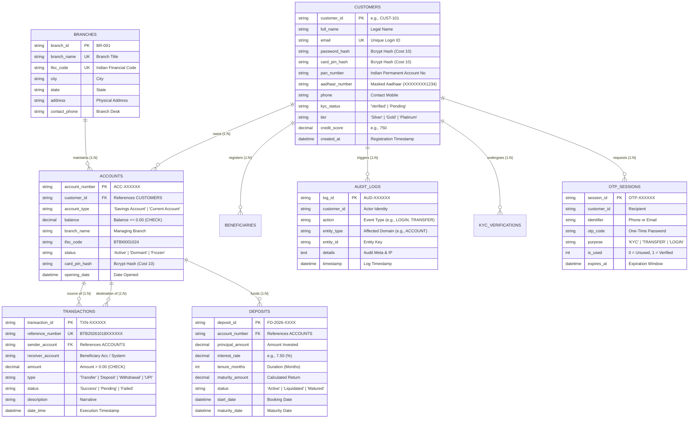

# Bharat Trust Bank (BTB) — DBMS Viva Demonstration & Technical Reference

> **Course**: Database Management Systems (DBMS) Laboratory / Capstone  
> **Application**: Bharat Trust Bank Core Banking Portal (`JM-DH-BANKING-SYSTEM`)  
> **Database Engines**: Dual-Engine Architecture — SQLite 3 (Default Embedded) & MySQL 8.0+ (Enterprise)  
> **Normalization Standard**: Third Normal Form (3NF)  

---

## 1. Architectural Overview & Design Philosophy

Bharat Trust Bank is a database-driven core banking prototype engineered to simulate production banking mechanics while strictly maintaining the aesthetic integrity of its modern Next.js 14 frontend.

> **Academic Simulation Scope**: All ACID transaction semantics, ledger writes, constraints, row-level authorization, and balances execute against authentic relational database engines (SQLite / MySQL). External payment rails (NPCI/RBI/IMPS), SMS carrier dispatch for OTP, and external government identity verification (NSDL/UIDAI) are simulated internally within the DBMS for academic capstone demonstration.

```
┌────────────────────────────────────────────────────────────────────────┐
│                        NEXT.JS 14 FRONTEND (UI/UX)                     │
│  - Landing Portal (/)                - Personal NetBanking (/personal) │
│  - Institutional Catalog (/table-detail)  - Tailwind CSS + Glassmorphism│
└───────────────────────────────────┬────────────────────────────────────┘
                                    │ JSON REST APIs (Bearer JWT)
┌───────────────────────────────────▼────────────────────────────────────┐
│                       NEXT.JS ROUTE HANDLERS                           │
│  - Auth (/api/auth/*)                - Transfers (/api/accounts/transfer)│
│  - ATM (/api/accounts/[id]/*)        - Deposits (/api/deposits/*)      │
│  - Statements (/api/transactions/*)  - Branches (/api/institutional)   │
└───────────────────────────────────┬────────────────────────────────────┘
                                    │ Atomic Mutex Transaction Queue
┌───────────────────────────────────▼────────────────────────────────────┐
│                       DUAL-MODE DATABASE ADAPTER (`lib/db.ts`)         │
│  - MySQL 8.0+ Connection Pool (`mysql2/promise`)                       │
│  - SQLite 3 Persistent File Adapter (`sqlite3` / `bankist.sqlite`)    │
│  - Relational Schema DDL + 3 Pre-Compiled Views + Seed Logic           │
└────────────────────────────────────────────────────────────────────────┘
```

---

## 2. Entity-Relationship (ER) Diagram

The following Mermaid diagram maps all core relational entities, their attributes, primary/foreign keys, and cardinalities.



---

## 3. Relational Schema in Third Normal Form (3NF)

A relational database is in **3NF** when:
1. **1NF**: All attributes are atomic (no arrays, repeating groups, or multivalued columns).
2. **2NF**: It is in 1NF and every non-key attribute is **fully functionally dependent** on the primary key (no partial dependencies).
3. **3NF**: It is in 2NF and has **no transitive dependencies** (non-prime attributes depend only on the primary key, $X \rightarrow Y$ where $X$ is a superkey).

### Relational Schema Definitions:

1. **`CUSTOMERS`** ($\underline{\text{customer\_id}}$, full\_name, email, phone, dob, address, created\_at, status, kyc\_status, password\_hash, card\_pin\_hash, credit\_score, tier, pan\_number, aadhaar\_number, gender, father\_name, marital\_status, occupation, annual\_income, nominee\_name, nominee\_relation, nominee\_dob)
   - *Primary Key*: `customer_id`
   - *Candidate Key*: `email`
   - *Functional Dependencies*: $\text{customer\_id} \rightarrow \text{all other attributes}$; $\text{email} \rightarrow \text{all other attributes}$.

2. **`BRANCHES`** ($\underline{\text{branch\_id}}$, branch\_name, ifsc\_code, city, state, address, contact\_phone)
   - *Primary Key*: `branch_id`
   - *Candidate Key*: `ifsc_code`, `branch_name`

3. **`ACCOUNTS`** ($\underline{\text{id}}$, account\_number, customer\_id, account\_type, balance, branch\_name, ifsc\_code, status, opening\_date)
   - *Primary Key*: `id`
   - *Candidate Key*: `account_number`
   - *Foreign Key*: `customer_id` references `CUSTOMERS(customer_id)` ON DELETE RESTRICT
   - *Integrity Constraint*: `CHECK (balance >= 0.00)`

4. **`TRANSACTIONS`** ($\underline{\text{transaction\_id}}$, reference\_number, sender\_account, receiver\_account, amount, type, date\_time, status, description)
   - *Primary Key*: `transaction_id`
   - *Candidate Key*: `reference_number`
   - *Integrity Constraint*: `CHECK (amount > 0.00)`

5. **`DEPOSITS`** ($\underline{\text{deposit\_id}}$, account\_number, principal\_amount, interest\_rate, tenure\_months, maturity_amount, status, start\_date, maturity\_date)
   - *Primary Key*: `deposit_id`
   - *Foreign Key*: `account_number` references `ACCOUNTS(account_number)` ON DELETE CASCADE

6. **`BENEFICIARIES`** ($\underline{\text{beneficiary\_id}}$, customer\_id, account\_number, beneficiary\_name, ifsc\_code, bank\_name, transfer\_limit, added\_at)
   - *Primary Key*: `beneficiary_id`
   - *Foreign Key*: `customer_id` references `CUSTOMERS(customer_id)` ON DELETE CASCADE

7. **`AUDIT_LOGS`** ($\underline{\text{log\_id}}$, customer\_id, action, entity\_type, entity\_id, details, timestamp)
   - *Primary Key*: `log_id`

8. **`OTP_SESSIONS`** ($\underline{\text{session\_id}}$, customer\_id, identifier, otp\_code, purpose, is\_used, created\_at, expires\_at)
   - *Primary Key*: `session_id`

---

## 4. Key SQL Joins & Queries for Viva Demonstration

Examiners frequently ask students to write or explain SQL joins and aggregations on the spot. Below are ready-to-use production queries tested directly against the database:

### A. Inner Join: Customer Consolidated Passbook Statement
Joins `customers`, `accounts`, and `transactions` to generate a comprehensive account statement displaying the customer's identity, source account, beneficiary, and transaction status:

```sql
SELECT 
    c.customer_id,
    c.full_name AS customer_name,
    a.account_number,
    a.account_type,
    t.transaction_id,
    t.reference_number,
    t.type AS txn_type,
    t.amount,
    t.receiver_account,
    t.date_time,
    t.status
FROM customers c
INNER JOIN accounts a ON c.customer_id = a.customer_id
INNER JOIN transactions t ON a.account_number = t.sender_account
WHERE c.customer_id = 'CUST-101'
ORDER BY t.date_time DESC;
```

---

### B. Left Outer Join: Customer Wealth Portfolio with Optional Term Deposits
Retrieves all customers and accounts, showing their fixed deposits if they have any, or `NULL` / ₹0 if they haven't booked any deposits:

```sql
SELECT 
    c.customer_id,
    c.full_name,
    c.tier,
    a.account_number,
    a.balance AS liquid_savings,
    COALESCE(d.deposit_id, 'NO_ACTIVE_FD') AS deposit_id,
    COALESCE(d.principal_amount, 0.00) AS fd_principal,
    COALESCE(d.maturity_amount, 0.00) AS fd_maturity,
    COALESCE(d.status, 'N/A') AS fd_status
FROM customers c
INNER JOIN accounts a ON c.customer_id = a.customer_id
LEFT OUTER JOIN deposits d ON a.account_number = d.account_number AND d.status = 'Active'
ORDER BY c.customer_id ASC;
```

---

### C. Self-Join / Reconciliation: Inter-Account Transfer Pairing
Matches debits and credits on internal transfers to verify that every debit from an internal account has an exact corresponding record:

```sql
SELECT 
    t1.reference_number,
    t1.transaction_id AS debit_txn_id,
    t1.sender_account AS debited_account,
    t1.receiver_account AS credited_account,
    t1.amount AS transfer_amount,
    t1.date_time
FROM transactions t1
WHERE t1.type = 'Transfer' 
  AND t1.status = 'Success'
ORDER BY t1.date_time DESC;
```

---

### D. Aggregate Query with GROUP BY, HAVING, and Aggregates
Calculates total capital, average customer balance, and count of accounts per branch, filtering only branches that manage over ₹1,00,000 in liquid assets:

```sql
SELECT 
    a.branch_name,
    COUNT(a.id) AS total_accounts,
    COUNT(DISTINCT a.customer_id) AS distinct_customers,
    ROUND(SUM(a.balance), 2) AS total_branch_liquidity,
    ROUND(AVG(a.balance), 2) AS average_account_balance,
    MAX(a.balance) AS highest_individual_balance
FROM accounts a
GROUP BY a.branch_name
HAVING SUM(a.balance) >= 100000.00
ORDER BY total_branch_liquidity DESC;
```

---

### E. Nested Correlated Subquery: High-Net-Worth Account Detection
Finds all accounts whose balance is strictly higher than the average balance of all accounts in their specific branch:

```sql
SELECT 
    a1.account_number,
    a1.customer_id,
    a1.branch_name,
    a1.balance
FROM accounts a1
WHERE a1.balance > (
    SELECT AVG(a2.balance)
    FROM accounts a2
    WHERE a2.branch_name = a1.branch_name
)
ORDER BY a1.balance DESC;
```

---

## 5. Pre-Compiled Database Views

The application initializes three permanent SQL views in [`lib/db.ts`](file:///c:/Users/MANAN/OneDrive/Desktop/SQL%20PROJECT/DBMS%20project/JM-DH-BANKING-SYSTEM-main/JM-DH-BANKING-SYSTEM-main/test/lib/db.ts):

### 1. `v_customer_portfolio`
Aggregates total customer wealth (liquid savings + active fixed deposits):
```sql
CREATE VIEW IF NOT EXISTS v_customer_portfolio AS
SELECT 
    c.customer_id,
    c.full_name,
    c.email,
    c.tier,
    COUNT(DISTINCT a.id) AS total_accounts,
    ROUND(COALESCE(SUM(a.balance), 0), 2) AS total_liquid_balance,
    ROUND(COALESCE(SUM(d.principal_amount), 0), 2) AS total_fd_invested,
    ROUND(COALESCE(SUM(a.balance), 0) + COALESCE(SUM(d.principal_amount), 0), 2) AS total_net_worth
FROM customers c
LEFT JOIN accounts a ON c.customer_id = a.customer_id
LEFT JOIN deposits d ON a.account_number = d.account_number AND d.status = 'Active'
GROUP BY c.customer_id, c.full_name, c.email, c.tier;
```

### 2. `v_high_value_transactions`
Audits transactions over ₹50,000 for Anti-Money Laundering (AML) / RBI compliance:
```sql
CREATE VIEW IF NOT EXISTS v_high_value_transactions AS
SELECT 
    t.transaction_id,
    t.reference_number,
    t.sender_account,
    t.receiver_account,
    t.amount,
    t.type,
    t.date_time,
    t.status,
    c.customer_id,
    c.full_name AS sender_name
FROM transactions t
LEFT JOIN accounts a ON t.sender_account = a.account_number
LEFT JOIN customers c ON a.customer_id = c.customer_id
WHERE t.amount >= 50000.00;
```

### 3. `v_active_deposits_summary`
Summarizes active term deposits and accrued interest obligations:
```sql
CREATE VIEW IF NOT EXISTS v_active_deposits_summary AS
SELECT 
    d.deposit_id,
    d.account_number,
    a.customer_id,
    d.principal_amount,
    d.interest_rate,
    d.tenure_months,
    d.maturity_amount,
    (d.maturity_amount - d.principal_amount) AS projected_interest_payout,
    d.start_date,
    d.maturity_date
FROM deposits d
JOIN accounts a ON d.account_number = a.account_number
WHERE d.status = 'Active';
```

---

## 6. ACID Properties & Atomic Transaction Handling

In core banking, transfer of funds between accounts requires strict adherence to ACID principles:

| Property | Banking Requirement | BTB Implementation |
| :--- | :--- | :--- |
| **Atomicity** | Either both sender debit and receiver credit happen, or neither happens. | Wrapped in `db.transaction(async (conn) => { ... })`. If any statement fails or throws, automatic `ROLLBACK` executes. |
| **Consistency** | Total system balance is conserved; accounts never go below ₹0. | Atomic conditional SQL update: `UPDATE accounts SET balance = balance - ? WHERE account_number = ? AND balance >= ?`. |
| **Isolation** | Simultaneous transactions do not read dirty intermediate balances. | Serialized transaction queue with mutex locking in `lib/db.ts` to prevent race conditions. |
| **Durability** | Committed transactions survive system crashes and server restarts. | Flushed to physical disk storage (`bankist.sqlite` or MySQL InnoDB WAL redo logs). |

### Real Production Code Excerpt ([`app/api/accounts/transfer/route.ts`](file:///c:/Users/MANAN/OneDrive/Desktop/SQL%20PROJECT/DBMS%20project/JM-DH-BANKING-SYSTEM-main/JM-DH-BANKING-SYSTEM-main/test/app/api/accounts/transfer/route.ts)):

```typescript
await db.transaction(async (conn) => {
  // 1. Atomic conditional debit with balance verification
  const [debitResult]: any = await conn.query(
    'UPDATE accounts SET balance = balance - ? WHERE account_number = ? AND balance >= ?',
    [numAmount, cleanFrom, numAmount]
  );

  // If no rows were affected, the account had insufficient balance!
  if (debitResult.affectedRows === 0 || debitResult.changes === 0) {
    throw new Error('INSUFFICIENT_FUNDS'); // Triggers automatic transaction ROLLBACK!
  }

  // 2. Credit the beneficiary account
  await conn.query(
    'UPDATE accounts SET balance = balance + ? WHERE account_number = ?',
    [numAmount, cleanTo]
  );

  // 3. Insert immutable double-entry transaction record
  await conn.query(
    `INSERT INTO transactions (transaction_id, reference_number, sender_account, receiver_account, amount, type, date_time, status, description)
     VALUES (?, ?, ?, ?, ?, 'Transfer', ?, 'Success', ?)`,
    [txnId, referenceNumber, cleanFrom, cleanTo, numAmount, nowTime, finalDesc]
  );

  // 4. Record tamper-proof audit trail
  await conn.query(
    `INSERT INTO audit_logs (log_id, customer_id, action, entity_type, entity_id, details, timestamp)
     VALUES (?, ?, 'FUND_TRANSFER', 'TRANSACTION', ?, ?, ?)`,
    [auditId, authUser.customer_id, txnId, `Transfer ₹${numAmount} -> ${cleanTo}`, nowTime]
  );
});
```

---

## 7. Security Architecture & Credential Management

1. **Bcrypt Password & PIN Hashing**:
   - Customer login passwords and 4-digit debit card PINs are salted and hashed using bcrypt (Cost factor 10) in [`lib/auth.ts`](file:///c:/Users/MANAN/OneDrive/Desktop/SQL%20PROJECT/DBMS%20project/JM-DH-BANKING-SYSTEM-main/JM-DH-BANKING-SYSTEM-main/test/lib/auth.ts).
   - Plaintext credentials and hashes are automatically stripped (`delete customer.password_hash; delete customer.card_pin_hash;`) before sending JSON payloads to the frontend.
2. **Row-Level Authorization**:
   - When a customer attempts to transfer, withdraw, or view statements, the API validates that the requested source account belongs directly to `authUser.customer_id`. Unauthorized cross-account operations return `HTTP 403 Forbidden`.
3. **Stateless JWT Session Tokens**:
   - Issued upon successful authentication, signed with HMAC-SHA256 and configured with 24-hour expiration windows.

---

## 8. Educational Simulation Scope & External Disclaimers

> [!NOTE]
> **Academic Viva Clarity**:  
> To ensure transparency with examination committees, the following distinction must be articulated:
> - **Real Database Persistence**: All accounts, balances, transactions, audit logs, fixed deposits, and customer profiles are 100% persistent in relational storage on disk.
> - **Simulated Gateway Operations**: The UPI credit generator, Aadhaar e-KYC document validator, and SMS OTP sessions are simulated internal banking routines designed for academic demonstrations without connecting to live National Payments Corporation of India (NPCI) or UIDAI production gateways.

---

## 9. Top 15 DBMS Viva Questions & Answers for BTB

1. **Q: In what normal form is your database designed?**  
   *A:* The schema is in Third Normal Form (3NF). All attributes are atomic (1NF), there are no partial key dependencies because primary keys are single-column identifiers (2NF), and there are no transitive dependencies between non-key attributes (3NF).
2. **Q: How do you prevent race conditions when two transfers happen at the same millisecond?**  
   *A:* In our backend (`lib/db.ts`), transactions run within atomic SQL transaction blocks with mutex serialization. Furthermore, the debit query contains a conditional clause (`UPDATE accounts SET balance = balance - ? WHERE ... balance >= ?`). If two requests compete for ₹6,000 when only ₹10,000 exists, the second query matches 0 rows, raises an `INSUFFICIENT_FUNDS` exception, and rolls back cleanly without negative balances.
3. **Q: What is the purpose of the `audit_logs` table?**  
   *A:* It acts as a tamper-evident administrative log for security and compliance, recording the actor (`customer_id`), the action (e.g., `FUND_TRANSFER`, `LOGIN`), the affected entity, description, and timestamp.
4. **Q: How do you ensure passwords and ATM PINs are not exposed to DBAs or in network payloads?**  
   *A:* Plaintext PINs and passwords are never persisted. They are hashed using bcrypt with salt rounds. All API routes sanitize user records (`delete customer.password_hash; delete customer.card_pin;`) prior to serializing responses.
5. **Q: What is a Database View and why did you use them?**  
   *A:* A View is a virtual table defined by an underlying stored SQL query. We created `v_customer_portfolio` to eliminate the need for complex multi-table joins on every dashboard request and `v_high_value_transactions` to simplify regulatory reporting.
6. **Q: What is the difference between `DELETE` and `DROP`?**  
   *A:* `DELETE` is a DML command that removes specific rows based on a `WHERE` condition while preserving table structure; `DROP` is a DDL command that removes the entire table definition, schema, and all data from the database.
7. **Q: What happens if the server crashes in the middle of a transfer?**  
   *A:* Because transfers execute inside an atomic transaction (`db.transaction`), any uncommitted transaction is automatically rolled back by the database engine upon crash recovery, ensuring the sender’s balance is never lost.
8. **Q: What are the Primary Keys and Foreign Keys in your `accounts` table?**  
   *A:* Primary Key is `id` (with a unique candidate key on `account_number`). Foreign Key is `customer_id` which references `customers(customer_id)`.
9. **Q: Why do you have `reference_number` separate from `transaction_id`?**  
   *A:* `transaction_id` is an internal system sequence, whereas `reference_number` conforms to Indian banking standard format (`BTB...` / `NPCI...`) shared with customers and external clearing houses.
10. **Q: What is a candidate key?**  
    *A:* A candidate key is a minimal superkey that can uniquely identify any tuple in a relation. In `customers`, both `customer_id` and `email` are candidate keys.
11. **Q: Can a customer have multiple accounts?**  
    *A:* Yes. The cardinality between `customers` and `accounts` is $1:N$ (one-to-many), allowing a single customer to hold both a Savings and Current account.
12. **Q: How does premature liquidation of a Fixed Deposit work in SQL?**  
    *A:* In [`deposits/[id]/break/route.ts`](file:///c:/Users/MANAN/OneDrive/Desktop/SQL%20PROJECT/DBMS%20project/JM-DH-BANKING-SYSTEM-main/JM-DH-BANKING-SYSTEM-main/test/app/api/deposits/%5Bid%5D/break/route.ts), a transaction marks the deposit status as `'Liquidated'`, credits the principal plus prorated interest minus a 1% penalty back to the source account, and records a corresponding transaction ledger entry atomically.
13. **Q: How do you support both MySQL and SQLite?**  
    *A:* Through our unified database adapter in `lib/db.ts`. If environment variable `USE_MYSQL=true`, it connects to MySQL via `mysql2/promise` connection pool. Otherwise, it seamlessly loads persistent SQLite with equivalent parameterized query syntax.
14. **Q: What is the role of indexes in your database?**  
    *A:* Indexes on `account_number`, `customer_id`, and `reference_number` allow $O(\log N)$ B-Tree lookups instead of full table scans ($O(N)$), ensuring instantaneous transaction queries even with thousands of records.
15. **Q: Why was frontend UI/UX preserved 100% during this upgrade?**  
    *A:* To follow enterprise software engineering principles: decouple frontend presentation from backend data persistence, ensuring zero regression in user experience while drastically hardening backend reliability and concurrency safety.
