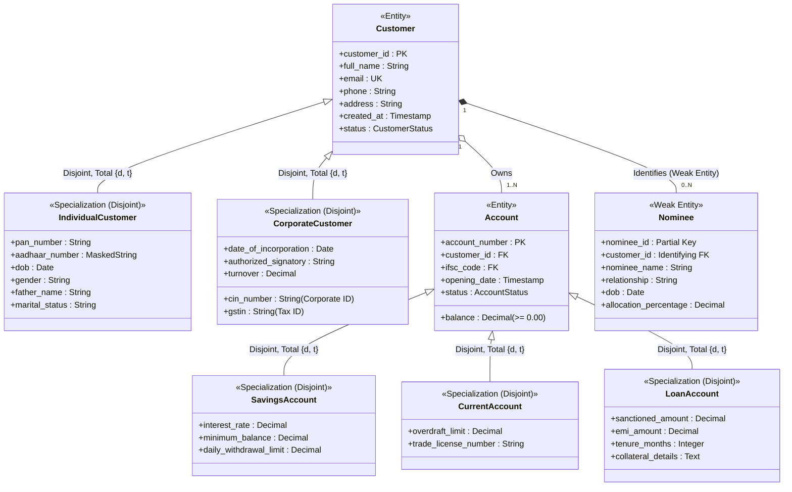

# JM-DH Banking System — Entity-Relationship (ER) & Enhanced ER (EER) Modeling

**Standard**: Relational Database Design & Conceptual EER Modeling  
**Target RDBMS**: MySQL 8.0+ (Enterprise) & SQLite 3 (Embedded)  
**Author**: Senior Database Architect  

---

## 1. Architectural Scope & Methodological Distinction

In strict accordance with database engineering rigor, this document enforces a clear boundary between:

1. **The Currently Implemented Physical Relational Schema**: The authentic 9 tables currently existing in `bankist.sql` and `lib/db.ts` that power the active core banking portal.
2. **The Enhanced Conceptual EER Model**: An academic, conceptual generalization/specialization model designed for comprehensive enterprise banking evaluation, demonstrating total vs. partial and disjoint vs. overlapping constraints, weak entities, and composite attributes.
3. **The Implemented Relational Mapping**: The precise translation of these conceptual structures into production MySQL 8.0 DDL without introducing table bloat or redundant complexity.

---

## 2. Currently Implemented Physical ER Model

The physical relational schema implements nine production entities supporting retail banking operations:

```mermaid
erDiagram
    CUSTOMERS ||--o{ ACCOUNTS : "owns (1:N)"
    CUSTOMERS ||--o{ BENEFICIARIES : "registers (1:N)"
    CUSTOMERS ||--o{ KYC_VERIFICATIONS : "undergoes (1:N)"
    CUSTOMERS ||--o{ DEPOSITS : "subscribes (1:N)"
    CUSTOMERS ||--o{ AUDIT_LOGS : "generates (1:N)"
    CUSTOMERS ||--o{ OTP_SESSIONS : "authenticates (1:N)"
    BRANCHES ||--o{ ACCOUNTS : "maintains (1:N via IFSC)"
    ACCOUNTS ||--o{ TRANSACTIONS : "debits / sender (0:N)"
    ACCOUNTS ||--o{ TRANSACTIONS : "credits / receiver (0:N)"
    ACCOUNTS ||--o{ DEPOSITS : "funds / linked_account (1:N)"

    CUSTOMERS {
        varchar(50) customer_id PK "Unique Customer ID"
        varchar(150) full_name "Legal Full Name"
        varchar(150) email UK "Unique Login ID"
        varchar(30) phone "Contact Mobile"
        date dob "Date of Birth"
        text address "Physical Residential Address"
        enum status "'Active', 'Suspended', 'Pending'"
        enum kyc_status "'Verified', 'Pending', 'Rejected'"
        varchar(255) password_hash "Bcrypt Hash (Work Factor 10)"
        varchar(255) card_pin_hash "Bcrypt Hash for 4-Digit Debit PIN"
        int credit_score "Credit Rating (300-900)"
        enum tier "'Silver', 'Gold', 'Platinum', 'VIP'"
        varchar(20) pan_number "Permanent Account Number"
        varchar(20) aadhaar_number "Masked Aadhaar (XXXXXXXX1234)"
        datetime created_at "Registration Timestamp"
    }

    ACCOUNTS {
        varchar(50) account_number PK "Unique Account Number (ACC-XXXXXX)"
        varchar(50) customer_id FK "References CUSTOMERS(customer_id)"
        varchar(50) account_type "'Savings Account', 'Current Account'"
        decimal balance "Liquid Balance >= 0.00"
        varchar(20) ifsc_code FK "References BRANCHES(ifsc_code)"
        varchar(100) branch_name "Branch Name"
        enum status "'Active', 'Frozen', 'Closed'"
        varchar(255) card_pin_hash "Account-Specific Bcrypt PIN Hash"
        datetime opening_date "Account Opening Timestamp"
    }

    TRANSACTIONS {
        varchar(50) transaction_id PK "Unique Transaction ID (TXN-XXXXXX)"
        varchar(50) sender_account "Debit Account (NULL for Inward Deposits)"
        varchar(50) receiver_account "Credit Account (NULL for Outward Withdrawals)"
        decimal amount "Monetary Value > 0.00"
        varchar(30) type "'Transfer', 'Deposit', 'Withdrawal', 'UPI'"
        datetime date_time "Execution Timestamp"
        varchar(30) status "'Success', 'Failed', 'Pending'"
        varchar(100) reference_number UK "Unique UTR / Payment Reference"
        text description "Transaction Narrative"
    }

    KYC_VERIFICATIONS {
        varchar(50) verification_id PK "Unique Verification Event ID"
        varchar(50) customer_id FK "References CUSTOMERS(customer_id)"
        varchar(50) document_type "'PAN_CARD', 'AADHAAR_UIDAI', 'VIDEO_KYC', etc."
        varchar(50) document_number "Masked Identifier / Token"
        varchar(50) verification_method "Audit Method"
        varchar(30) status "'Verified', 'Pending', 'Rejected'"
        datetime verified_at "Audit Timestamp"
        text remarks "Compliance Officer / System Notes"
    }

    BENEFICIARIES {
        varchar(50) beneficiary_id PK "Unique Beneficiary Record ID"
        varchar(50) customer_id FK "References CUSTOMERS(customer_id)"
        varchar(150) beneficiary_name "Payee Legal Name"
        varchar(50) account_number "Destination Account (Inter-bank or Intra-bank)"
        varchar(20) ifsc_code "Payee Branch IFSC"
        varchar(150) bank_name "Payee Bank Organization"
        decimal transfer_limit "Max Single Transaction Limit"
        datetime cooling_until "Anti-Fraud Cooling Threshold"
        tinyint is_active "1 = Active, 0 = Inactive"
        datetime created_at "Registration Timestamp"
    }

    DEPOSITS {
        varchar(50) deposit_id PK "Unique Deposit ID (FD-XXXX / RD-XXXX)"
        varchar(50) customer_id FK "References CUSTOMERS(customer_id)"
        varchar(50) linked_account "Funding Account Number"
        varchar(50) deposit_type "'Fixed Deposit', 'Recurring Deposit'"
        decimal principal_amount "Principal Sum Invested > 0.00"
        decimal interest_rate "Annual Percentage Rate (APR)"
        int tenure_months "Term in Months >= 1"
        decimal maturity_amount "Maturity Yield"
        date maturity_date "Maturity Maturity Horizon"
        enum status "'Active', 'Matured', 'Liquidated'"
        datetime created_at "Booking Timestamp"
    }

    BRANCHES {
        varchar(50) branch_id PK "Branch Identifier (BR-XXX)"
        varchar(100) branch_name "Official Branch Name"
        varchar(20) ifsc_code UK "Unique 11-Character IFSC Code"
        varchar(100) city "Operating City"
        text address "Physical Street Address"
        varchar(50) timing "Operational Hours"
        varchar(30) phone "Telephone Contact"
        varchar(20) status "'Active', 'Closed'"
    }

    AUDIT_LOGS {
        varchar(50) log_id PK "Immutable UUID Log Entry"
        varchar(50) customer_id "Actor / Subject Customer"
        varchar(100) action "Event Code (e.g., TRANSFER_SUBMITTED)"
        varchar(50) entity_type "Target Entity (e.g., ACCOUNT, CUSTOMER)"
        varchar(50) entity_id "Target Primary Key Value"
        text details "Structured JSON Audit Payload (Redacted)"
        datetime timestamp "Event Ingestion Timestamp"
    }

    OTP_SESSIONS {
        varchar(50) session_id PK "Unique Challenge Session UUID"
        varchar(150) identifier "Destination Mobile / Email"
        varchar(50) purpose "'LOGIN', 'TRANSFER_VERIFY', 'PASSWORD_RESET'"
        varchar(255) otp_hash "One-Way Bcrypt Hash of OTP"
        bigint expires_at "Epoch Expiry Threshold"
        int verified "1 = Verified, 0 = Pending"
        int attempts "Failed Attempt Counter"
        bigint last_sent_at "Rate-Limiting Cooldown Timestamp"
        datetime created_at "Issuance Timestamp"
    }
```

### Relational Facts & Cardinality Constraints

1. **Customers to Accounts ($1:N$)**: Total participation on `accounts` (every account must have an owner), partial on `customers` (a new customer may exist before opening an account). Referential Action: `ON DELETE CASCADE`.
2. **Customers to Beneficiaries ($1:N$)**: Owned by `customer_id`. The destination `account_number` is a string attribute, NOT a foreign key, because beneficiaries frequently belong to third-party financial institutions (e.g., HDFC, SBI, ICICI).
3. **Accounts to Transactions ($1:N$ Dual Cardinality)**:
   - Outward Transfers / Withdrawals: `sender_account` references `accounts(account_number)`.
   - Inward Transfers / Deposits: `receiver_account` references `accounts(account_number)`.
   - Cash deposits have `sender_account = NULL`; cash withdrawals have `receiver_account = NULL`.
4. **Customers to Deposits ($1:N$)**: Primary legal ownership is held by `customer_id` (`ON DELETE CASCADE`), while `linked_account` records the operative liquid account from which funds were debited and to which maturity proceeds will be credited.
5. **Branches to Accounts ($1:N$)**: Linked via the foreign key `ifsc_code` matching `branches(ifsc_code)`.

---

## 3. Enhanced Conceptual EER Model (Specialization & Generalization)

For advanced academic DBMS evaluation, the domain is modeled below using Enhanced Entity-Relationship (EER) concepts, highlighting inheritance, specialization, disjoint/overlapping constraints, and weak entities:

### EER Formal Constraint Analysis

1. **Customer Specialization Hierarchy**:
   - **Superclass**: `Customer`
   - **Subclasses**: `IndividualCustomer`, `CorporateCustomer`
   - **Disjointness Constraint**: **Disjoint $\{d\}$**. A customer cannot simultaneously be an individual natural person and an incorporated legal corporate entity.
   - **Completeness Constraint**: **Total Specialization $\{t\}$**. Every customer registered with the bank must be classified as either an Individual or Corporate entity.
2. **Account Specialization Hierarchy**:
   - **Superclass**: `Account`
   - **Subclasses**: `SavingsAccount`, `CurrentAccount`, `LoanAccount`
   - **Disjointness Constraint**: **Disjoint $\{d\}$**. An account instance holds a specific operating contract and cannot be both a liability product (Savings) and an asset product (Loan).
   - **Completeness Constraint**: **Total Specialization $\{t\}$**. Every account instance belongs to exactly one specialized account subtype.
3. **Nominee as a Weak Entity**:
   - **Owner Entity**: `Customer`
   - **Identifying Relationship**: `Customer_Nominee`
   - **Partial Key**: `nominee_name` + `relationship` (within the scope of a customer)
   - **Primary Key**: Composite (`customer_id`, `nominee_name`)
   - **Existence Dependency**: A nominee cannot exist without an associated customer. If the customer record is purged, the nominee record ceases to have legal standing (`ON DELETE CASCADE`).

---

## 4. Final Relational Schema Mapping Strategy

When mapping the conceptual EER model to physical relational tables, there are three classic design alternatives:
1. **Single Table with Type Discriminator (Single-Table Inheritance)**: All attributes collapsed into a single table with nullable specialized columns.
2. **Class-Table Inheritance (Joined Table Inheritance)**: Superclass table storing shared attributes, joined via primary-key-as-foreign-key to specialized subclass tables.
3. **Concrete-Table Inheritance (Table-per-Subclass)**: Individual tables for each concrete subclass with duplicate shared columns.

### Architectural Decision for JM-DH Banking System
- In our production schema, we employ **Class-Table / Extension Mapping** for critical distinct entities (`kyc_verifications`, `beneficiaries`, `deposits`, `audit_logs`) while maintaining lean superclasses (`customers`, `accounts`).
- This guarantees **Third Normal Form (3NF) and Boyce-Codd Normal Form (BCNF)** compliance, minimizes `NULL` values, and ensures maximum query throughput on core balance operations.
